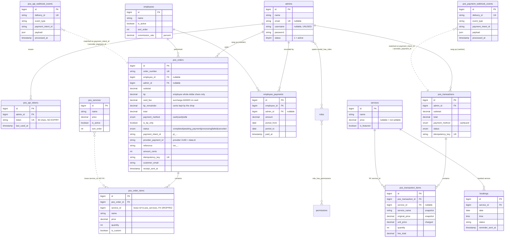

# PROJECT BRIEF — nexobarbers.com

> **Audience:** an architect who has never opened this codebase.
> **Method:** read-only inspection of the repository at commit `df0eb3c` (branch `claude/optimistic-saha-318412`), plus the Flutter app that lives outside it, plus live verification against the production host.
> **Date:** 2026-11-08
> **Rule followed:** anything not determinable from the code is marked **UNKNOWN**. Nothing is guessed.

Two older documents in the repo root — `PROJECT_OVERVIEW.md` and `STACK_FINDINGS.md` — are dated 2026-07-19 and describe the project **before either POS existed**. They state that `routes/api.php` is empty and that no POS is built. Both are now false. Treat them as historical planning artifacts, not as current documentation.

---

## 1. OVERVIEW

### 1.1 What the product is

A single Laravel 11 application serving **one barbershop** — Nexo Barbers, Arlington Heights, Illinois — in four distinct roles:

| Role | Users | Entry point |
|---|---|---|
| Marketing website + appointment booking | Public visitors | `/` |
| Admin dashboard (CMS + POS back-office + reports) | Shop owner | `/admin` |
| **Web POS** (browser till) | Cashier | `/pos` |
| **Mobile POS API** (consumed by an Android tablet app) | Cashier on a tablet | `/api/pos/v1` |

There is **no multi-tenancy** and no subscription/SaaS layer. One shop, one database. See §2.2.

### 1.2 Critical structural fact: there are TWO independent POS systems

They share the database and the PlutoPay merchant account but **nothing else** — separate tables, services, controllers, webhooks and reconciliation jobs. This is the single most important thing to understand before changing anything.

| | **Web POS** | **Mobile POS** |
|---|---|---|
| Surface | Browser, `/pos` | Flutter Android tablet app |
| Sales table | `pos_transactions` + `pos_transaction_items` | `pos_orders` + `pos_order_items` |
| Service catalog | `services` (shared with website) | `pos_services` (dedicated) |
| Auth | Session, `pos` guard | Bearer token, `pos_api_tokens` |
| Payment service namespace | `App\Services\Pos\*` | `App\Services\NexoPos\*` |
| Webhook endpoint | `POST /webhooks/plutopay` | `POST /webhooks/nexo-pos-plutopay` |
| Webhook events table | `pos_payment_webhook_events` | `pos_api_webhook_events` |
| Reconcile command | `ReconcileCardPayments` | `nexo-pos:reconcile-cards` |
| Employee attribution | **None** (cashier only) | Yes (`employee_id`) |
| Tips | **None** | Yes, with a fraction rule (§2.3) |
| Card surcharge | **None** | Yes (§2.3) |
| Live keys | **Blocked** at construction ([PlutoPayClient.php:43](app/Services/Pos/Payment/PlutoPayClient.php)) | Allowed (`allow_live` defaults `true`) |
| Tests | ~50 tests | **Zero** |
| Live usage | 4 rows, last activity 2026-07-21 — **effectively dead** | 625 orders, $28,006 settled |

**Verified on production (2026-10-06):** `pos_transactions` holds 4 rows with `MAX(id)=4`, last written 2026-07-21. The Web POS is abandoned code that still runs, still has a scheduled reconciliation job, and still shares the payment account. The Mobile POS is the real system.

### 1.3 Repo layout

Single Laravel repo — not a monorepo. The Flutter app is **not in version control at all**.

```
/                         Laravel 11 app (this repo)
  app/ bootstrap/ config/ database/ public/ resources/ routes/ storage/ tests/
  deploy/                 Production files that live outside the web root (§1.6)
  docs/PROJECT_BRIEF.md   This file
  POS_PLAN.md POS_CARD_PLAN.md PROJECT_OVERVIEW.md STACK_FINDINGS.md   Stale planning docs

~/Desktop/apps/nexo_pos   Flutter tablet app — NOT a git repository (verified)
```

### 1.4 Tech stack

**Backend** (`composer.json`)
- PHP `^8.2` — production runs **8.3.33** (verified via `php -v` on the host)
- Laravel Framework `^11.0` — installed `11.48.0`
- `spatie/laravel-permission ^6.9` — roles/permissions, actively used
- `maatwebsite/excel ^3.1`, `intervention/image 2.7`, `php-ffmpeg/php-ffmpeg ^1.3`
- `laravel/passport ^12.3`, `laravel/socialite ^5.18`, `socialiteproviders/apple ^5.6` — registered in [bootstrap/providers.php](bootstrap/providers.php) but **unused**: no Passport-guarded route exists, no social login route is active
- Providers registered: `AppServiceProvider`, Spatie, Excel, Passport, Image, Socialite

**Frontend** — Blade, server-rendered. No SPA.
- Marketing site: **Tailwind v4**, pre-compiled to `public/frontend_assets/src/output.css`. Does **not** go through Vite.
- Admin dashboard: **Metronic** (Bootstrap 5) in `public/admin_assets/`, with DataTables, FullCalendar, TinyMCE/Summernote.
- Vite `^5.0` + `laravel-vite-plugin` build `resources/sass/app.scss` and `resources/js/app.js` (Bootstrap 5 + Sass) — used by the admin side only.
- Two CSS frameworks coexist by surface. The POS web page (`resources/views/pos/`) is **UNKNOWN** which one it uses — not inspected in detail.

**Mobile** (`~/Desktop/apps/nexo_pos/pubspec.yaml`) — Flutter, version `1.0.4+5`
- `dio ^5.4.0` (HTTP), `provider ^6.1.0` (state), `flutter_secure_storage ^9.0.0` (token + reader id), `shared_preferences ^2.2.0`, `google_fonts ^6.1.0`, `ota_update ^7.1.0` + `package_info_plus ^5.0.0` (self-update)
- **No local database and no offline queue** (verified: no `sqflite`/`hive`/`isar`/offline code anywhere in `lib/`). The app is online-only — see §9.1.
- **No printer package.** The "PRINT RECEIPT" button is a stub showing *"Printer not connected yet — coming soon."* (`~/Desktop/apps/nexo_pos/lib/screens/pos/success_screen.dart`)

**Database** — MySQL. 75 migrations, 56 application tables. Session, cache and queue all use the `database` driver (`.env.example`).

### 1.5 Environments and config

`.env` key **names** present in [.env.example](.env.example):

`APP_NAME APP_ENV APP_KEY APP_DEBUG APP_URL APP_TIMEZONE APP_LOCALE APP_FALLBACK_LOCALE APP_FAKER_LOCALE APP_MAINTENANCE_DRIVER APP_MAINTENANCE_STORE BCRYPT_ROUNDS LOG_CHANNEL LOG_STACK LOG_DEPRECATIONS_CHANNEL LOG_LEVEL DB_CONNECTION DB_HOST DB_PORT DB_DATABASE DB_USERNAME DB_PASSWORD SESSION_DRIVER SESSION_LIFETIME SESSION_ENCRYPT SESSION_PATH SESSION_DOMAIN BROADCAST_CONNECTION FILESYSTEM_DISK QUEUE_CONNECTION CACHE_STORE CACHE_PREFIX MEMCACHED_HOST REDIS_CLIENT REDIS_HOST REDIS_PASSWORD REDIS_PORT MAIL_MAILER MAIL_HOST MAIL_PORT MAIL_USERNAME MAIL_PASSWORD MAIL_ENCRYPTION MAIL_FROM_ADDRESS MAIL_FROM_NAME MAIL_ADMIN_EMAIL AWS_ACCESS_KEY_ID AWS_SECRET_ACCESS_KEY AWS_DEFAULT_REGION AWS_BUCKET AWS_USE_PATH_STYLE_ENDPOINT VITE_APP_NAME FACEBOOK_CLIENT_ID FACEBOOK_CLIENT_SECRET FACEBOOK_REDIRECT_URI GOOGLE_CLIENT_ID GOOGLE_CLIENT_SECRET GOOGLE_REDIRECT_URI APPLE_CLIENT_ID APPLE_CLIENT_SECRET APPLE_REDIRECT_URI PROJECT_INITIALIZED PLUTOPAY_BASE_URL PLUTOPAY_SECRET_KEY PLUTOPAY_PUBLISHABLE_KEY PLUTOPAY_WEBHOOK_SECRET PLUTOPAY_TERMINAL_ID PLUTOPAY_READER_ID PLUTOPAY_CURRENCY PLUTOPAY_RETRIEVE_PATH NEXO_POS_VERSION_CODE NEXO_POS_VERSION_NAME NEXO_POS_APK_URL NEXO_POS_MANDATORY NEXO_POS_RELEASE_NOTES NEXO_POS_PLUTOPAY_BASE_URL NEXO_POS_PLUTOPAY_SECRET_KEY NEXO_POS_PLUTOPAY_PUBLISHABLE_KEY NEXO_POS_PLUTOPAY_WEBHOOK_SECRET NEXO_POS_PLUTOPAY_TERMINAL_ID NEXO_POS_PLUTOPAY_READER_ID NEXO_POS_PLUTOPAY_CURRENCY`

**Keys the code reads that `.env.example` does NOT document** — a new deployment gets silent defaults:

| Key | Default | Defined in |
|---|---|---|
| `NEXO_POS_EDIT_ORDER_PIN` | `'1975'` | [config/nexo_pos.php:21](config/nexo_pos.php) |
| `NEXO_POS_PLUTOPAY_MIN_CENTS` | `50` | [config/nexo_pos.php:36](config/nexo_pos.php) |
| `NEXO_POS_PLUTOPAY_RETRIEVE_PATH` | `v1/transactions/{id}` | [config/nexo_pos.php:40](config/nexo_pos.php) |
| `NEXO_POS_PLUTOPAY_LIST_PATH` | `v1/transactions` | [config/nexo_pos.php:45](config/nexo_pos.php) |
| `NEXO_POS_PLUTOPAY_ALLOW_LIVE` | **`true`** | [config/nexo_pos.php:47](config/nexo_pos.php) |

`APP_TIMEZONE` defaults to **`America/Chicago`** ([config/app.php:68](config/app.php)). This is load-bearing — see §2.4.

**Hosting** (verified by SSH to the production host):
- Hostinger shared hosting, CloudLinux 8, `us-bos-web1387`, PHP 8.3.33
- App root: `~/domains/nexobarbers.com/nexo`
- Document root: `~/domains/nexobarbers.com/public_html` — a **sibling** directory, not `nexo/public`
- Deploy method: `git pull` on the server, then `php artisan migrate --force && php artisan config:cache`. There is **no deploy script in the repo**.
- `shell_exec` is disabled, so interactive `php artisan tinker` is unavailable. Diagnostics must be written as artisan commands (§7.4).
- Server load observed at 13–14; PHP CLI processes are routinely **OOM-killed** mid-command. This can silently kill scheduled jobs.

**CI:** **UNKNOWN** — no `.github/workflows`, no `.gitlab-ci.yml`, no CI config of any kind in the repo.

**Build/deploy scripts:** **UNKNOWN** beyond `composer.json` scripts (standard Laravel post-install hooks) and `package.json` (`npm run dev` / `build`).

### 1.6 The front controller is outside version control — and it has already caused a full outage

`public_html/index.php` must reference the app one directory **over**, not one directory **up**:

```php
require __DIR__.'/../nexo/vendor/autoload.php';            // correct
(require_once __DIR__.'/../nexo/bootstrap/app.php')        // correct
```

On **2026-10-06 at 10:03** this file was overwritten with a copy of [public/index.php](public/index.php), whose paths (`../vendor/autoload.php`) are correct only from inside `public/`. Composer's autoloader was not found, so **every request returned HTTP 500 with an empty body** — homepage, admin and the POS API alike. Because the failure happens before Laravel boots far enough to log, `storage/logs/laravel.log` recorded nothing; its last entry was from 2026-09-22. Diagnosis required running the front controller by hand with `display_errors=1`.

A canonical copy is now tracked at [deploy/public_html-index.php](deploy/public_html-index.php) with [deploy/README.md](deploy/README.md). **Who or what overwrote the file is UNKNOWN** — if it was an automated process, it will recur.

---

## 2. DATA MODEL

### 2.1 Tables

56 application tables (plus Laravel/Passport infrastructure). Grouped by purpose.

#### Transactional core — Mobile POS (the live system)

| Table | Purpose | Key columns |
|---|---|---|
| `pos_orders` | One sale, or one standalone tip, from the tablet | `order_number` (unique, `N{ymd}{hex5}`), `employee_id`, `admin_id`, `subtotal`, `tip`, `card_fee`, `tip_remainder`, `total`, `payment_method` (`cash\|card\|zelle`), `is_tip_only`, `status` (`completed\|awaiting_payment\|processing\|failed\|canceled`), `payment_intent_id`, `provider_payment_id`, `reference`, `amount_cents`, `currency`, `failure_reason`, `idempotency_key` (unique), `customer_email`, `receipt_sent_at`, `notes` |
| `pos_order_items` | Line items | `pos_order_id`, `service_id` (**loose reference, no FK** — see §9.3), `name`, `price`, `quantity`, `is_custom` |
| `employees` | Barbers — "who performed the service". **Not** login accounts | `name`, `avatar`, `is_active`, `sort_order`, `commission_rate` (decimal 5,2 — a percentage) |
| `employee_payments` | Payout ledger | `employee_id`, `admin_id`, `amount`, `period_from`, `period_to`, `paid_at`, `notes` |
| `pos_services` | Tablet-only service catalog, priced independently of the website | `name`, `price`, `is_active`, `sort_order` |
| `pos_api_tokens` | Bearer tokens for the tablet | `admin_id`, `name`, `token` (60 chars, unique), `last_used_at` — **no expiry column** |
| `pos_api_webhook_events` | Inbound PlutoPay events (audit + dedupe) | `delivery_id` (unique), `event_type`, `payment_intent_id`, `payload` (json), `processed_at` |

#### Transactional core — Web POS (effectively dead)

| Table | Purpose | Key columns |
|---|---|---|
| `pos_transactions` | One browser-till sale | `admin_id`, `subtotal`, `total`, `payment_method` (`cash\|card`), `status`, `reference`, `payment_intent_id`, `provider_payment_id`, `currency`, `amount_cents`, `failure_reason`, `idempotency_key` (unique) |
| `pos_transaction_items` | Line items, with price snapshots | `pos_transaction_id`, `service_id` (FK → `services`, nullOnDelete), `service_name`, `original_price`, `unit_price`, `quantity`, `line_total` |
| `pos_payment_webhook_events` | Same shape as the mobile events table | `delivery_id` (unique), `event_type`, `payment_intent_id`, `payload`, `processed_at` |

#### Booking

| Table | Purpose |
|---|---|
| `bookings` | Appointment: `date`, `time`, `status` (`pending\|confirmed\|…`), `service_id`, `reminder_sent_at` |
| `consultations` | Consultation request form |
| `opening_hours` | **Exists but is not used by the booking logic** (§9.4) |

#### Auth / ACL

| Table | Purpose |
|---|---|
| `admins` | Every staff account: owner, cashiers. `name`, `email` (unique, nullable), `username` (nullable, **unused**), `password`, `phone_code`, `phone`, `status`, `image` |
| `users` | Website end-users. Model and table exist; **all registration/login routes are commented out** ([routes/web.php:21-31](routes/web.php)) |
| Spatie: `roles`, `permissions`, `model_has_roles`, `model_has_permissions`, `role_has_permissions` | Roles/permissions on `guard_name = 'admin'` |
| Passport: `oauth_*` (5 tables) | Present, unused |

#### CMS / marketing content

`abouts`, `achievements`, `approaches`, `banners`, `blogs`, `categories`, `clients`, `countries`, `events`, `faqs`, `features`, `hows`, `instagrams`, `menu_items`, `newsletters`, `reasons`, `reason_tabs`, `sections`, `services`, `settings`, `skills`, `sliders`, `static_pages`, `teams`, `testimonials`, `user_messages`, `works`

These are flat, standalone content tables with no relationships to each other. `services` is the exception — it is shared by the website, the booking form and the Web POS, and carries a `price` column added for the POS ([2026_07_19_120000](database/migrations/2026_07_19_120000_add_price_to_services_table.php)).

#### E-commerce scaffolding — built, never wired up

`products`, `product_images`, `product_attributes`, `attributes`, `attribute_values`, `variants`, `variant_attribute_values`, `inventories`

Full CRUD exists in the dashboard. There is **no cart, no checkout, no orders table, and no storefront** for any of it. Dead weight.

### 2.2 Multi-tenancy

**There is none.** No `tenant_id`, `store_id`, `company_id` or `location_id` on any table. No tenant scoping middleware, no global scopes. One shop, one database, one `admins` table. Any future multi-location work is greenfield.

### 2.3 Money

**Storage.** Every monetary column is `DECIMAL(10,2)`. `pos_orders.amount_cents` is an additional `UNSIGNED INTEGER` holding the exact integer cents sent to the payment processor, for audit and reconciliation.

**No tax. No discounts.** There is no tax table, no tax rate setting, and no discount mechanism anywhere in either POS. [CartCalculator.php:191](app/Services/Pos/CartCalculator.php) says so explicitly: *"No tax/discount in this phase, so total == subtotal."*

**Web POS arithmetic** — [app/Services/Pos/CartCalculator.php](app/Services/Pos/CartCalculator.php) is a clean, framework-free, integer-cents calculator. Prices are validated by strict regex (`/^\d+(\.\d{1,2})?$/`), bounded by `MAX_UNIT_PRICE = 1,000,000` and `MAX_QUANTITY = 10,000`, and converted once via `(int) round($value * 100)`. The server **always** re-resolves prices from the DB and ignores any total sent by the browser ([TransactionController.php:27](app/Http/Controllers/Pos/TransactionController.php)). This is the best-engineered money code in the repo — and it belongs to the dead system.

**Mobile POS arithmetic** — float-based, spread across three files. There is no equivalent calculator class.

Three house rules, all specific to the mobile POS:

**(a) Card surcharge — ADDED on top, never deducted.**
```php
$cardFee = $data['payment_method'] === 'card' ? PosSettings::cardFee() : 0.0;
$total   = round($subtotal + $cardFee + $tip, 2);
```
[PosApiController.php:163](app/Http/Controllers/Api/Pos/V1/PosApiController.php). The fee is a flat amount from `settings.pos_card_fee` ([PosSettings.php:20](app/Support/PosSettings.php)), applied to card only — never cash or Zelle. It is snapshotted onto the order so a later settings change cannot rewrite history. A $31 service with a $1 fee charges the customer **$32**, and the processor is charged $32 too ([CardPaymentController.php:88](app/Http/Controllers/Api/Pos/V1/CardPaymentController.php)).

**(b) Card-tip fraction rule — the employee gets whole dollars, the house keeps the cents.**
```php
$employeeTipCents = intdiv($tipCents, 100) * 100;
$remainderCents   = $tipCents - $employeeTipCents;
```
[NexoPosWebhookController.php:110](app/Http/Controllers/Webhooks/NexoPosWebhookController.php). A $12.70 card tip credits the employee $12.00 and moves $0.70 into shop fees. Split in integer cents so no float rounding can leak a cent. `pos_orders.tip` holds **only the employee's whole-dollar share**; `tip_remainder` holds the fraction.

**(c) Standalone tips (`is_tip_only = 1`)** — a tip handed over after the ticket is closed. Stored as a `pos_order` with no items and `subtotal = 0`, so it inherits employee/cashier/timestamp plumbing ([PosApiController.php:224](app/Http/Controllers/Api/Pos/V1/PosApiController.php)). Counts as employee tip income but **never** as shop takings.

**Derived accessors** — [app/Models/PosOrder.php:52-80](app/Models/PosOrder.php):

| Accessor | Formula | Use |
|---|---|---|
| `customer_tip` | `tip + tip_remainder` | What the customer actually tipped — customer-facing receipts |
| `shop_fees` | `card_fee + tip_remainder` | Everything the shop keeps as fees |
| `chargeable_total` | `subtotal + card_fee + tip + tip_remainder` | What the customer is charged |

**The settled-only rule.** This is the project's most important invariant, and it is enforced by scopes rather than a global scope ([PosOrder.php:110-150](app/Models/PosOrder.php)):

- `scopeSettled()` → `status = 'completed'` only
- `scopeSales()` → settled **and** `is_tip_only = false`
- `scopeTipOnly()` → settled **and** `is_tip_only = true`
- `scopeCompletedIn($from, $to)` → settled + a date-range filter

A card sale sits at `awaiting_payment`/`processing` until the webhook confirms it, and may end `failed`/`canceled` — money never moved on those. Counting them would overstate takings and pay employees for sales that never happened. It is deliberately **not** a global scope because the card flow itself must find its own pending rows to drive them. Every read path funnels through these scopes.

**Refunds: not implemented.** There is no refund table, column, route or command. The mobile API explicitly refuses to delete a card order and tells the operator to refund on the physical reader instead ([PosApiController.php:333](app/Http/Controllers/Api/Pos/V1/PosApiController.php)). Refunds therefore exist only in the processor's records and **never appear in this system's books** — see §9.1.

**Balances.** The only running balance is payroll, computed on the fly (never stored) in [EmployeeReportController.php:43-105](app/Http/Controllers/Admin/EmployeeReportController.php) — formula in §4.4.

### 2.4 Timezone — load-bearing and subtly wrong

`APP_TIMEZONE = America/Chicago`, and no connection timezone is set in [config/database.php](config/database.php). Laravel therefore writes `created_at` as a **Chicago-local naive datetime**. Verified empirically: the first order on a trading day reads `09:29:37`, consistent with a 9 AM opening.

But four read paths convert their range boundaries to **UTC** before querying that Chicago-local column:

```php
->whereBetween('created_at', [
    $from->copy()->startOfDay()->utc(),
    $to->copy()->endOfDay()->utc(),
])
```

Found in [PosOrder.php:147](app/Models/PosOrder.php) (`scopeCompletedIn`), [EmployeeReportController.php:38](app/Http/Controllers/Admin/EmployeeReportController.php), [EmployeeReportController.php:151](app/Http/Controllers/Admin/EmployeeReportController.php) (payment history), and [TransactionsController.php:36](app/Http/Controllers/Admin/TransactionsController.php).

A request for "2026-08-28" actually queries `2026-08-28 05:00` → `2026-08-29 04:59` **in shop time**. The window is shifted five hours (six under CST).

**Current impact: masked, not harmless.** The shop is closed between midnight and 05:00, so no real orders fall in the misattributed band. It becomes a live bug the moment the shop opens early, a late sale lands after midnight, or `employee_payments.paid_at` is recorded outside business hours — `paid_at` is written with `now()` (Chicago) and compared against the same UTC boundaries.

A fifth path does it differently: [PosOrderController.php:35](app/Http/Controllers/Admin/PosOrderController.php) uses `whereDate('created_at', …)`, which is correct. So the "POS Orders" screen and the "Transactions" screen apply **different date semantics to the same data** and can legitimately disagree.

### 2.5 ERD

The CMS tables are flat and unrelated, so this diagram covers the transactional core, booking and auth. CMS/e-commerce tables are listed in §2.1.



---

## 3. AUTH & ROLES

### 3.1 Guards

[config/auth.php](config/auth.php) — note that **three** guards share one `admins` table:

| Guard | Driver | Provider | Model | Used by |
|---|---|---|---|---|
| `admin` | session | `admins` | `App\Models\Admin` | Dashboard `/admin` |
| `pos` | session | `admins` | `App\Models\Admin` | Web POS `/pos` |
| `web` / `user` | session | `users` | `App\Models\User` | Nothing — all routes commented out |
| `user_api` | passport | `users` | `App\Models\User` | Nothing |

The mobile POS uses **no guard at all** — it authenticates via a custom bearer-token middleware.

### 3.2 The three login flows

**Dashboard** — `GET/POST /admin/login` → [Admin\Auth\LoginController](app/Http/Controllers/Admin/Auth/LoginController.php), guard `admin`, email + password. Protected by `['auth:admin', 'admin', 'admin.role']`.

**Web POS** — `GET/POST /pos/login` → [Pos\AuthController::login](app/Http/Controllers/Pos/AuthController.php). Guard `pos`. Checks three things: credentials, `status = 1`, and the `pos.access` permission — logging the user straight back out if the permission is missing. *(The class docblock says "username + password" but the code validates `email`. Doc drift.)*

**Mobile POS** — `POST /api/pos/v1/login` → [PosApiController::login](app/Http/Controllers/Api/Pos/V1/PosApiController.php). Looks up an `Admin` by email, `Hash::check`s the password, and issues a 60-character random token via `PosApiToken::issue()`.

### 3.3 Permission matrix and where it is enforced

| Surface | Authentication | Authorization | Enforced in |
|---|---|---|---|
| `/admin/*` | `auth:admin` | **`admin` role required** | [EnsureAdminRole.php:24](app/Http/Middleware/EnsureAdminRole.php) — 403 without it |
| `/pos/*` | `pos` guard | **`pos.access` permission** | [PosAuthenticate.php:28](app/Http/Middleware/PosAuthenticate.php) — 403 without it |
| `/api/pos/v1/*` | bearer token | **NONE** | [PosApiAuth.php](app/Http/Middleware/PosApiAuth.php) |
| `/webhooks/*` | HMAC-SHA256 signature | n/a | [PlutoPaySignature](app/Services/NexoPos/Payment/PlutoPaySignature.php) |

Permissions are seeded by [PermissionSeeder.php:60](database/seeders/PermissionSeeder.php) and [PosSeeder.php:25](database/seeders/PosSeeder.php), both creating `pos.access` on `guard_name = 'admin'`. Spatie's `role`/`permission`/`role_or_permission` middleware are aliased in [bootstrap/app.php:38](bootstrap/app.php) but **not applied to any route**.

The dashboard design is deliberate and well-tested: cashiers hold `pos.access` but not the `admin` role, so a cashier who authenticates through the admin login form still cannot reach any dashboard page. [tests/Feature/Admin/DashboardAccessTest.php](tests/Feature/Admin/DashboardAccessTest.php) covers exactly this.

**The mobile API breaks that model** — see §9.2.

---

## 4. DASHBOARD

All routes in [routes/admin.php](routes/admin.php), prefix `admin`, middleware `['auth:admin', 'admin', 'admin.role']`. Views follow `admin.<module>.{index,create,show}`. Every module exposes `GET {module}/data/datatables` for server-side jQuery DataTables; most also expose `POST {module}/activate/{id}`.

### 4.1 Dashboard home

`GET /admin` → [Admin\HomeController::index](app/Http/Controllers/Admin/HomeController.php) → `admin.home.index`

Shows **marketing-site metrics only** — clients, services, works, blogs and testimonials counts, works grouped by category, and monthly series for works/clients/blogs/newsletter subscribers. **No POS or revenue figure appears on the landing page.** The owner must navigate to Reports or Transactions to see money.

### 4.2 POS back-office modules

| Module | Route | Controller | View | What it does |
|---|---|---|---|---|
| POS Orders | `GET admin/pos-orders` | [PosOrderController](app/Http/Controllers/Admin/PosOrderController.php) | `admin.pos_orders.index` | **Read-only** list of tablet sales. `scopeSettled()` only. Filters: employee, payment method, date from/to (via `whereDate`). Detail at `/{id}` → `admin.pos_orders.show` |
| Transactions | `GET admin/transactions` | [TransactionsController](app/Http/Controllers/Admin/TransactionsController.php) | `admin.transactions.index` | Full ledger — every field of every settled tablet sale. Filters: date range, employee, cashier, payment method, free-text over `order_number`/`customer_email`/`reference`/`payment_intent_id`. Paginates 50. Totals computed over the **whole filtered set** with one `selectRaw`, not just the visible page |
| POS Transactions | `GET admin/pos-transactions` | [PosTransactionController](app/Http/Controllers/Admin/PosTransactionController.php) | `admin.pos_transactions.index` | Read-only list of **Web POS** sales. 4 rows in production |
| Employees | `admin/employees` (resource, no `show`) | [EmployeeController](app/Http/Controllers/Admin/EmployeeController.php) | `admin.employees.{index,create}` | CRUD for barbers: name, avatar, `is_active`, `sort_order`, `commission_rate` |
| POS Services | `admin/pos-services` (resource, no `show`) | [PosServiceController](app/Http/Controllers/Admin/PosServiceController.php) | `admin.pos_services.{index,create}` | CRUD for the tablet catalog. Also `POST pos-services/import` → `importFromWebsite()`, which seeds `pos_services` from the website `services` table |
| POS Settings | `GET/POST admin/pos-settings` | [PosSettingController](app/Http/Controllers/Admin/PosSettingController.php) | `admin.pos_settings.index` | One field: `pos_card_fee`, validated `required\|numeric\|min:0\|max:1000`, stored in the generic `settings` table under key `pos_card_fee` |

### 4.3 Reports — exact computation

Hub at `GET admin/reports` → `admin.reports.index`. All three report actions call `parseRange()`, which builds Carbon dates in `config('app.timezone')` and defaults to the **last 30 days** (`subDays(29)`).

**Scope for every report: `pos_orders` only.** The Web POS table is deliberately never mixed in, so figures stay unambiguous ([ReportsController.php:13](app/Http/Controllers/Admin/ReportsController.php)).

#### Sales — `GET admin/reports/sales` → [ReportsController::sales](app/Http/Controllers/Admin/ReportsController.php)

Base set: `PosOrder::completedIn($from, $to)->where('is_tip_only', false)->get()` — loaded into memory, then aggregated with Collection methods.

| Metric | Computation |
|---|---|
| `orders` | `count()` |
| `gross` | `SUM(total)` |
| `subtotal` | `SUM(subtotal)` |
| `card_fees` | `SUM(card_fee) + SUM(tip_remainder)` |
| `tips` | `SUM(tip)` — employee share only, **not** what the customer tipped |
| `cash` / `card` / `zelle` | `SUM(total)` filtered by `payment_method` |
| `*_count` | row counts per payment method |
| `avg_ticket` | `SUM(total) / count()`, or `0.0` when empty |
| `daily[]` | the same metrics grouped by `created_at->format('Y-m-d')`, sorted descending |

#### Services — `GET admin/reports/services`

A real SQL aggregate over `pos_order_items`, constrained by `whereHas('posOrder', fn($q) => $q->completedIn(...)->where('is_tip_only', false))`:

```sql
SELECT name, is_custom,
       SUM(quantity)        AS qty,
       SUM(price*quantity)  AS revenue,
       COUNT(*)             AS line_count
GROUP BY name, is_custom
ORDER BY revenue DESC
```

Grouped by **name**, not `service_id` — so a renamed service splits into two rows, and a custom-price line groups with other custom lines of the same name.

#### Cashiers — `GET admin/reports/cashiers`

Settled non-tip orders grouped by `admin_id` in PHP. Per cashier: `orders`, `gross` (`SUM(total)`), `cash`/`zelle`/`card` splits, `fees` (`SUM(card_fee) + SUM(tip_remainder)`), `tips` (`SUM(tip)`). Sorted by `gross` descending.

### 4.4 Payroll — `GET admin/reports/employees`

[EmployeeReportController::index](app/Http/Controllers/Admin/EmployeeReportController.php). This is the screen the owner uses to decide what to pay. Per employee, over the range:

```
sales        = settled orders WHERE is_tip_only = 0
direct_tips  = SUM(tip) WHERE is_tip_only = 1
subtotal     = SUM(sales.subtotal)
tips         = SUM(tip) over ALL orders        (service tips + direct tips)
fees         = SUM(sales.card_fee) + SUM(sales.tip_remainder)   -- shown, never in the commission base
commission   = subtotal * (employee.commission_rate / 100)       -- Employee::commissionOn()
earned       = commission + tips
paid         = SUM(employee_payments.amount) WHERE paid_at IN range
balance      = earned - direct_tips - paid
```

The `- direct_tips` term is the subtle part: a standalone tip is already in the employee's pocket, so it counts as *earned* but must not inflate what the shop still **owes**.

Also exposed: `cash_total`/`cash_tips`, `zelle_total`/`zelle_tips`, `card_total`/`card_tips` — how the money physically arrived, drawer versus bank.

Actions:

| Action | Route | Validation |
|---|---|---|
| Record a payout | `POST admin/reports/employees/pay` | `employee_id` exists, `amount` numeric ≥ 0.01, `period_from`/`period_to` nullable dates with `after_or_equal`, `notes` ≤ 1000 chars |
| Payout history | `GET admin/reports/employees/{id}/history` | defaults to the last 90 days |
| Delete a payout | `DELETE admin/reports/employees/payments/{id}` | **No validation, no confirmation, no soft delete** — `findOrFail` then `delete()` |

### 4.5 CMS modules

~34 near-identical resource controllers. Each is `Route::resource` plus a `data/datatables` endpoint, and many add `activate/{id}`.

| Module | Route prefix | Controller |
|---|---|---|
| Accounts (admins + roles) | `accounts` | `AccountController` |
| Admins | `admins` | `AdminController` (+ bulk delete) |
| Users | `users` | `UserController` (+ bulk delete) |
| Roles | `roles` | `RoleController` |
| Settings | `settings` | `SettingController` (index + update only) |
| Services | `services` | `ServiceController` |
| Bookings | `bookings` | `BookingController` (+ `calendar`, `calendar-events`) |
| Products / Attributes / AttributeValues / Categories | `products`, `attributes`, `attribute_values`, `categories` | respective controllers |
| Static pages, Newsletters, Testimonials, Achievements, Banners, Blogs, Clients, Features, FAQs, Reasons, Teams, Skills, Galleries, How, Abouts, Events, Instagrams, Menu items, Approaches, Sliders | one each | one each |
| Contacts | `contacts` | `ContactController` (+ `reply/{contact}/reply`) |
| Sections (homepage toggles) | `sections/{id}/toggle`, `sections/{section}/update` | `SectionController` |
| About / Contact page editors | `about_page`, `contact_page` | `HomeController` |

**Not present anywhere:** inventory movements, purchasing, suppliers, customers (as a CRM entity), deliveries, RFID/labels, drawer closeouts, shift management. The `inventories` table exists with no logic behind it.

---

## 5. POS

### 5.1 Entry points

**Mobile POS (live).** Flutter Android app, `~/Desktop/apps/nexo_pos`, version `1.0.4+5`. Talks to `https://nexobarbers.com/api/pos/v1` (`~/Desktop/apps/nexo_pos/lib/config/api_config.dart`). Screens: `login`, `pos_screen`, `card_payment_modal`, `tip_dialog`, `add_tip_dialog`, `custom_item_dialog`, `email_receipt_dialog`, `last_transactions_screen`, `success_screen`, `terminal_setup_screen`, `settings_sheet`.

**Offline support: none.** No local database, no outbox, no retry queue (verified). When the network or host is unavailable the tablet cannot record a sale at all — and staff then fall back to charging on the provider's own POS screen, producing sales with no order in this system. That is not hypothetical; see §9.1.

**Web POS (dead).** `/pos`, two Blade views. `TransactionController::store` hard-rejects card with a 422 ([TransactionController.php:36](app/Http/Controllers/Pos/TransactionController.php)), so only cash can be completed through it.

### 5.2 Mobile POS sale flow

```mermaid
sequenceDiagram
    autonumber
    participant C as Cashier (tablet)
    participant A as Flutter app
    participant API as /api/pos/v1
    participant P as PlutoPay
    participant R as Reader (tmr_…)
    participant W as /webhooks/nexo-pos-plutopay
    participant S as Scheduler

    Note over A,API: Startup
    A->>API: GET /app/version
    API-->>A: version_code, apk_url, mandatory
    A->>API: GET /employees, GET /services
    API-->>A: active employees; pos_services catalog

    C->>A: pick employee, then services (or Custom Service = price only)

    alt Cash or Zelle
        C->>A: tap CASH / ZELLE
        A->>C: tip prompt
        A->>API: POST /orders {employee_id, items[], tip, payment_method}
        Note right of API: subtotal recomputed server-side<br/>card_fee = 0<br/>total = subtotal + tip<br/>status = completed immediately
        API-->>A: 201 order
    else Card
        C->>A: tap CARD
        A->>API: POST /card/start {employee_id, items[], idempotency_key, reader_id}
        Note right of API: subtotal server-side<br/>card_fee = PosSettings::cardFee()<br/>chargeable = subtotal + card_fee<br/>reject if < min_amount_cents (50)<br/>INSERT status=awaiting_payment
        API->>P: create-payment (amount_cents, Idempotency-Key, metadata.pos_order_id)
        P-->>API: {id (UUID), payment_intent_id (pi_), reference (txn_)}
        API->>P: process-payment (payment_intent_id, reader_id)
        API-->>A: status=processing
        C->>R: customer taps card, enters tip ON THE READER
        R->>P: authorised
        P->>W: payment.succeeded {data.id, tip_amount, reference}
        Note right of W: verify HMAC on RAW body (300s window)<br/>dedupe on X-PlutoPay-Delivery<br/>lockForUpdate + isTerminal() guard<br/>tip split: intdiv(tip,100)*100<br/>total = subtotal+card_fee+tip+remainder<br/>status = completed
        loop every 1s, up to 90s
            A->>API: GET /card/status/{id}
            API-->>A: status
        end
        opt webhook never arrives
            Note over A: after 90s the modal stops spinning,<br/>warns NOT to charge again, offers an exit
            S->>P: nexo-pos:reconcile-cards (every minute)
            P-->>S: GET v1/transactions/{UUID} → status
            Note right of S: settles or fails the row<br/>⚠ response carries NO tip field (§9.1)
        end
    end

    API-->>A: order payload
    A->>C: success screen — PRINT RECEIPT (stub), SEND BY EMAIL, NEW ORDER
    opt email requested
        A->>API: POST /orders/{id}/email-receipt {email}
        API->>API: Mail::to(...)->send(PosReceiptMail)
    end
```

### 5.3 Cart, pricing, custom items

**Mobile.** The client sends `items[]` with `name`, `price`, `quantity`, `is_custom`. The server recomputes `subtotal` from those values but **does not validate `price` against the catalog** — the submitted price is authoritative ([PosApiController.php:157](app/Http/Controllers/Api/Pos/V1/PosApiController.php)). This is intentional (custom pricing, a "Custom Service" line that is price-only and always named *Custom Service*), with the consequence noted in §9.2.

**Web.** The opposite: every price is re-resolved from `services` and the browser's totals are discarded. A `NULL`-priced service is unsellable (`Service::isSellable()`), and a custom price may be exactly `0` only when the cashier set it deliberately (`allow_zero`).

### 5.4 Tips

| Path | Where the tip is captured | Stored as |
|---|---|---|
| Cash / Zelle | App dialog before submit (`~/Desktop/apps/nexo_pos/lib/screens/pos/tip_dialog.dart`) | `tip` in full (no fraction rule) |
| Card | **On the physical reader**, after the amount is sent | `tip` = whole dollars, `tip_remainder` = cents (§2.3b) |
| Standalone | ADD TIP button → `POST /tips` | `is_tip_only = 1`, `payment_method = cash` |

Because the card tip is entered on the reader, the payment intent is always created for the **base amount only** and the tip arrives later in the webhook. That is why losing a webhook loses a tip.

### 5.5 Payment integration — PlutoPay Terminal (Stripe-backed)

**Mobile files:** [PlutoPayClient](app/Services/NexoPos/Payment/PlutoPayClient.php), [PlutoPaySignature](app/Services/NexoPos/Payment/PlutoPaySignature.php), [CardPaymentController](app/Http/Controllers/Api/Pos/V1/CardPaymentController.php), [NexoPosWebhookController](app/Http/Controllers/Webhooks/NexoPosWebhookController.php).

Endpoints used: `POST v1/terminal/create-payment`, `POST v1/terminal/process-payment`, `POST v1/terminal/simulate-payment` (test-mode only), `GET v1/terminal/readers`, `GET v1/transactions/{id}`, `GET v1/transactions?date_from&date_to`.

**Identifier discipline** — three distinct ids, easy to confuse:

| Our column | Provider field | Shape | Addressable by `GET v1/transactions/{id}`? |
|---|---|---|---|
| `provider_payment_id` | `data.id` | UUID | **Yes — the only one** |
| `payment_intent_id` | `payment_intent_id` / `processor_transaction_id` | `pi_…` | No — returns **500**, not 404 |
| `reference` | `reference` | `txn_…` | No — returns 500 |

Confirmed by the provider and documented at [PlutoPayClient.php:131](app/Services/NexoPos/Payment/PlutoPayClient.php). Their `metadata.terminal_id` also carries two different identifier spaces depending on event shape (Stripe `tmr_…` on stamped rows, an internal UUID on others) — never match across them.

**Webhook security order** (must not be reordered — [NexoPosWebhookController.php:20](app/Http/Controllers/Webhooks/NexoPosWebhookController.php)):
1. Read the **raw** body — never a parsed body for signing
2. Verify HMAC-SHA256 over `"{timestamp}.{rawBody}"`, 300-second replay window, `hash_equals`
3. Dedupe on `X-PlutoPay-Delivery` via the unique `delivery_id` column
4. Apply the effect inside `DB::transaction` + `lockForUpdate()`, guarded by `isTerminal()`
5. Return 2xx fast, no outbound calls

Both webhook routes are CSRF-exempt ([bootstrap/app.php:57](bootstrap/app.php)).

**Idempotency.** `pos_orders.idempotency_key` is UNIQUE, so a double-tapped CARD button maps to one row; the same value is forwarded as the provider's `Idempotency-Key` (prefixed `nexo-app-`). A lost race on the unique key is caught and the winner's row reused ([CardPaymentController.php:133](app/Http/Controllers/Api/Pos/V1/CardPaymentController.php)).

**Failure handling.** A sale is settled **only** by the webhook or the reconcile job — never by the polling endpoint. Provider delivery is best-effort: **5 attempts over ~2.5 hours, then the event is dropped permanently** (stated by the provider). Hence the reconcile job is not optional.

**Reconciliation (mobile)** — [ReconcileNexoPosCards](app/Console/Commands/ReconcileNexoPosCards.php), `nexo-pos:reconcile-cards`, scheduled every minute:
- Finds `payment_method = card` with `status IN (awaiting_payment, processing)` older than `--minutes` (default 2), capped at `--limit` 50/run (provider allows 100 req/min, shared with live sales)
- Looks each up by **UUID only**; a clean 404 is reported as "unknown to the provider" rather than an error
- `PAID = [succeeded, completed, paid, captured]`, `DEAD = [failed, canceled, cancelled, expired, declined]`
- `--settle-only` records successes but never writes a failure — safe to run while the provider is replaying its queue, because `failed` is terminal and would turn every replay into a no-op
- `--dry-run` reports without writing

**Reconciliation (web)** — [ReconcileCardPayments](app/Console/Commands/ReconcileCardPayments.php), also every minute, against `PLUTOPAY_RETRIEVE_PATH` which defaults to **`v1/terminal/payment/{id}`** — a different path from the one the provider confirmed. See §9.3.

### 5.6 What does NOT exist in either POS

Returns · exchanges · refunds · layaway/deposits · split payments · voids · cash-drawer management · shift open/close · closeouts · discounts · tax · loyalty · customer accounts · barcode/RFID · label printing · working receipt printing · inventory effects of any kind.

A sale moves no stock. The `inventories` table is never touched by POS code.

---

## 6. WEBSITE

[routes/web.php](routes/web.php) → [Frontend\HomeController](app/Http/Controllers/Frontend/HomeController.php), views in `resources/views/frontend/`.

| Route | Method | Action | View |
|---|---|---|---|
| `/` | GET | `home` | `frontend.home` |
| `/service` | GET | `services` | `frontend.services` |
| `/gallery` | GET | `gallery` | `frontend.gallery` |
| `/contact_us` | GET | `contactUs` | `frontend.contact` |
| `/contact_us/store` | POST | `contactStore` | — |
| `/consult` | POST | `storeConsultation` | — |
| `/subscribe` | POST | `storeNewsletter` | — |
| `/services` | GET | `getServices` (JSON) | — |
| `/bookings` | POST | `storeBooking` | — |
| `/bookings/available-slots` | GET | `getAvailableSlots` (JSON) | — |

**Data source: the shared database, directly.** No API, no sync. `home()` reads `Slider::first()`, `About::first()`, featured `Work`s, and splits `Service` on `is_featured` (0 = services, 1 = packages). Homepage blocks are toggled through the `sections` table, keyed `services_section` and `contact_page`.

**Shared with the POS:** the `services` table — used by the website, the booking form **and** the Web POS. The mobile POS deliberately does not share it; it reads `pos_services` so POS prices can move without changing the public site.

**No e-commerce.** No cart, no checkout, no customer login (all auth routes commented out). The `products`/`variants`/`inventories` tables have no storefront.

**SEO:** `public/robots.txt` exists. Beyond that — meta tags, sitemap, structured data — **UNKNOWN**; the Blade templates were not audited for it.

**Booking slot logic** — [BookingSlotService](app/Services/BookingSlotService.php), 110 lines, with hours **hard-coded**:

| | Start | End | Interval |
|---|---|---|---|
| Sunday | 10:00 | 16:40 | 20 min |
| Mon–Sat | 09:00 | 19:40 | 20 min |

`BOOKING_DURATION_MINUTES = 20` is a constant. Overlap is checked by minute arithmetic against `pending`/`confirmed` bookings; past slots are excluded for today.

⚠️ **A requested rule is not in the code.** A variable interval — 10 minutes Wednesday–Saturday, 20 minutes otherwise, window 9 AM–6 PM — was asked for and is **not implemented**; `git log -S` finds no trace of it on any branch. The single-dropdown UI change that accompanied it *was* committed (`8d41dcc`). The `opening_hours` table exists and is unused. See §10.

---

## 7. INTEGRATIONS & BACKGROUND WORK

### 7.1 External APIs

| Service | Used by | Config |
|---|---|---|
| PlutoPay Terminal (Stripe-backed) | Both POS systems, separately | `config/nexo_pos.php` (mobile), `config/services.php` (web) |
| Facebook / Google / Apple OAuth | **Nothing** — Socialite installed, no active route | `config/services.php` |
| AWS S3 | **Nothing** — keys blank | `config/filesystems.php` |

### 7.2 Webhooks

| Endpoint | Handler | Table | CSRF |
|---|---|---|---|
| `POST /webhooks/plutopay` | [PlutoPayWebhookController](app/Http/Controllers/Webhooks/PlutoPayWebhookController.php) | `pos_payment_webhook_events` | exempt |
| `POST /webhooks/nexo-pos-plutopay` | [NexoPosWebhookController](app/Http/Controllers/Webhooks/NexoPosWebhookController.php) | `pos_api_webhook_events` | exempt |

Events handled: `payment.succeeded` / `payment_intent.succeeded` → `completed`; `payment.failed` / `payment_intent.payment_failed` → `failed`. Anything else is stored for audit with no state change. An event whose `data.id` matches no local row returns early — **the handler can never create an order**, only update one.

### 7.3 Scheduled tasks

[routes/console.php](routes/console.php) — all `->everyMinute()->withoutOverlapping()`:

| Command | Purpose |
|---|---|
| `SendBookingReminders` | Email reminder 30 minutes before an appointment |
| `ReconcileCardPayments` | Web POS card safety net |
| `ReconcileNexoPosCards` | Mobile POS card safety net |

Plus `inspire` (`->hourly()`), which is Laravel boilerplate.

⚠️ The host OOM-kills PHP processes under load (observed repeatedly). A killed scheduler tick is silent, so reconciliation can miss windows.

### 7.4 Artisan commands

| Command | File | Notes |
|---|---|---|
| `nexo-pos:setup-plutopay` | [SetupPlutoPay](app/Console/Commands/SetupPlutoPay.php) | Writes PlutoPay keys into `.env` (the host blocks interactive tinker) |
| `nexo-pos:reconcile-cards` | [ReconcileNexoPosCards](app/Console/Commands/ReconcileNexoPosCards.php) | `--minutes --limit --settle-only --dry-run` |
| `nexo-pos:card-diagnostics` | [DiagnoseNexoPosCards](app/Console/Commands/DiagnoseNexoPosCards.php) | Read-only. Card orders by status; orders in an id range; a day's activity; Web POS liveness; which webhooks touched an order |
| `nexo-pos:find-orphan-payments` | [FindOrphanNexoPosPayments](app/Console/Commands/FindOrphanNexoPosPayments.php) | Read-only. Provider charges with **no order on our side** — `--from --to --pages --dump` |
| `nexo-pos:repair-totals` | [RepairPosOrderTotals](app/Console/Commands/RepairPosOrderTotals.php) | Recomputes drifted `total`s |
| `nexo-pos:reset-data` | [ResetPosData](app/Console/Commands/ResetPosData.php) | **DESTRUCTIVE** — wipes `pos_order_items`, `pos_orders`, `employee_payments`, `pos_api_webhook_events`. Keeps services and employees |
| `pos:plutopay-register-reader` | [PlutoPayRegisterReader](app/Console/Commands/PlutoPayRegisterReader.php) | Registers a reader |
| `PlutoPayDevices` | [PlutoPayDevices](app/Console/Commands/PlutoPayDevices.php) | Lists devices |
| `project:init` | [InitializeProject](app/Console/Commands/InitializeProject.php) | ⚠️ **Broken** — imports `App\Models\PaymentGateway`, `App\Models\Subscription`, `App\Services\Payment\StripeDirectChargeService`, none of which exist. The README tells you to run this first |

### 7.5 Mail

`MAIL_MAILER` is `log` in `.env.example`; the production value is **UNKNOWN** but receipts demonstrably send, so SMTP is configured there. Mailables: `PosReceiptMail`, `BookingConfirmationMail`, `BookingReminderMail`, `AdminBookingNotification`, `AdminNotification`, `ContactReplyMail`, `VerificationCodeMail`. Views in `resources/views/mail/`.

**No SMS. No push notifications. No AI agents. No file storage beyond the `public` disk.**

### 7.6 Queues

`QUEUE_CONNECTION = database`; `jobs`, `job_batches` and `failed_jobs` tables exist. Whether a `queue:work` process actually runs in production is **UNKNOWN** — if it does not, any queued mail silently never sends.

---

## 8. API SURFACE

### 8.1 Mobile POS — `/api/pos/v1` (bearer token)

[routes/api.php](routes/api.php) → [PosApiController](app/Http/Controllers/Api/Pos/V1/PosApiController.php), [CardPaymentController](app/Http/Controllers/Api/Pos/V1/CardPaymentController.php)

| Method | Path | Auth | Payload / notes |
|---|---|---|---|
| GET | `health` | public | `{success, app, time}` |
| GET | `app/version` | public | `{version_code, version_name, apk_url, mandatory, release_notes}` — drives OTA |
| POST | `login` | public | `{email, password, device_name?}` → `{token, admin}` |
| GET | `me` | bearer | `{admin}` |
| POST | `logout` | bearer | deletes the token row |
| GET | `employees` | bearer | active employees: `id, name, avatar` |
| GET | `services` | bearer | active `pos_services`: `id, name, price` |
| POST | `orders` | bearer | `{employee_id, payment_method: cash\|card\|zelle, tip?, customer_email?, notes?, items[]{service_id?, name, price, quantity?, is_custom?}}` → 201 |
| POST | `tips` | bearer | `{employee_id, amount (0.01–10000), notes?}` → 201, `is_tip_only` |
| GET | `orders/recent?limit=` | bearer | settled only, 1–50, default 10 |
| GET | `orders/{id}` | bearer | **no ownership check** |
| POST | `orders/{id}/email-receipt` | bearer | `{email}` |
| PATCH | `orders/{id}/employee` | bearer | `{employee_id, pin}` — PIN via `hash_equals`, default `1975` |
| DELETE | `orders/{id}` | bearer | `{pin}` — **422 for card orders** |
| GET | `card/readers` | bearer | provider reader list |
| POST | `card/start` | bearer | `{employee_id, idempotency_key (8–64), reader_id?, items[], notes?, customer_email?}` |
| GET | `card/status/{id}` | bearer | scoped to `admin_id` |
| POST | `card/simulate/{id}` | bearer | sandbox only, scoped to `admin_id` |

`api/v1` exists as an empty legacy placeholder group.

### 8.2 Web POS — `/pos` (session, `pos` guard + `pos.access`)

| Method | Path | Notes |
|---|---|---|
| GET/POST | `pos/login`, POST `pos/logout` | public |
| GET | `pos/` | terminal screen |
| POST | `pos/transactions` | [StoreTransactionRequest](app/Http/Requests/Pos/StoreTransactionRequest.php); **card rejected 422** |
| POST | `pos/card/start` | [Pos\CardPaymentController](app/Http/Controllers/Pos/CardPaymentController.php) |
| GET | `pos/card/{transaction}/status` | polled |

### 8.3 Website (session/public)

See §6. All form posts are standard CSRF-protected Blade forms; `GET /services` and `GET /bookings/available-slots` return JSON.

### 8.4 Dashboard (session, `admin` guard + `admin` role)

~34 resource groups, each with a `data/datatables` JSON endpoint consumed by server-side DataTables. See §4.

### 8.5 Third parties

Inbound: the two webhook endpoints (HMAC-authenticated). Outbound: PlutoPay only.

---

## 9. CODE QUALITY & RISKS

Ordered by how much money or trust is at stake.

### 9.1 Money-losing defects

**(1) A reconciled card sale records a $0 tip — permanently.**
[ReconcileNexoPosCards::settle()](app/Console/Commands/ReconcileNexoPosCards.php) reads `$remote['tip_amount']`. The provider's `GET v1/transactions/{id}` **has no tip field at all** — verified by dumping the raw payload for a known-tipped charge:

```json
{ "id": "01a04aac-…", "amount": 5000, "amount_refunded": 0,
  "payment_method_type": "terminal", "captured_at": "...", "metadata": {...} }
```

No `tip_amount`, no `tip`. So `$tipCents` is always `0`, the `else` branch keeps `$fresh->tip` — which `card/start` initialised to `0` — and the order settles with no tip. The webhook path gets tips correctly; **only the fallback loses them**, and the fallback is precisely what runs when the webhook is lost. Every tip reconciled this way is silently removed from the employee's earnings. **Highest-priority fix.**

**(2) Charges taken outside the app are invisible until swept.**
The tablet is online-only. When it hangs, staff charge on the provider's own POS screens; those payments carry no `pos_order_id` and never become orders. On 28–29 August this produced **11 unmatched charges, $458 before tips**, found only by building [FindOrphanNexoPosPayments](app/Console/Commands/FindOrphanNexoPosPayments.php) after the fact. One of the eleven was dated **after** the incident window, so the behaviour recurs. Nothing alerts on it; the sweep must be run by hand.

**(3) Refunds never reach the books.**
Card orders cannot be deleted and must be refunded on the reader (§2.3). No refund is ever recorded here, so a refunded sale still counts as revenue and still pays commission.

**(4) The Web POS reconciler probably queries the wrong path.**
`PLUTOPAY_RETRIEVE_PATH` defaults to `v1/terminal/payment/{id}` ([config/services.php](config/services.php)) while the provider-confirmed path is `v1/transactions/{id}`. `ReconcileCardPayments` runs every minute against it. Low blast radius today — the Web POS has 4 rows — but it is a scheduled job making authenticated calls to an endpoint that may not exist. **Unverified: I did not call that path.**

### 9.2 Security

**(1) The mobile API performs no authorization at all.** [PosApiAuth](app/Http/Middleware/PosApiAuth.php) validates the bearer token and nothing else — no role, no permission, no `status` check. And [`POST /login`](app/Http/Controllers/Api/Pos/V1/PosApiController.php) issues a token to **any** `admins` row with a matching email and password, without checking `status` or `pos.access`. The other two surfaces both gate properly (`admin` role; `pos.access` + `status = 1`). Consequence: a deactivated account, or a content editor who was never meant to touch money, can log into the tablet and create, reassign and delete orders.

**(2) No rate limiting anywhere.** No `throttle` middleware in [bootstrap/app.php](bootstrap/app.php), on any route, or in any middleware. `POST /api/pos/v1/login` is freely brute-forceable, as is the 4-digit order PIN.

**(3) API tokens never expire.** `pos_api_tokens` has `last_used_at` but no expiry or revocation beyond explicit logout. A token lifted off a tablet is valid forever.

**(4) A 4-digit PIN guards order mutation.** `config('nexo_pos.edit_order_pin')` defaults to `'1975'`, is undocumented in `.env.example`, and is the only barrier to reassigning an order's employee (which moves commission between people) or deleting a cash/Zelle order. `hash_equals` is used correctly, but 10,000 possibilities with no rate limit is not a control.

**(5) Client-supplied prices are authoritative on the mobile path.** `items.*.price` is stored as sent (§5.3). A modified APK or a stolen token can ring any amount. The Web POS does the opposite. Intentional for custom pricing, but it means the tablet is trusted, not verified.

**(6) `APP_KEY` is committed.** The same key appears in `.env.example` and is tracked in git. Anyone with repo access can forge sessions and decrypt cookies on a deployment that kept it.

**(7) Operational credential exposure** — not code, but current and serious. The host's `serv.sh` prints a live GitHub PAT (`ghp_5T6FEW…`) to stdout on every invocation; it appeared four times in one working session and is stored in plaintext on shared hosting. The SSH account password was also typed into a chat transcript. Both should be rotated. Key-based SSH already works, so the password is not needed.

**(8) Mass assignment** — `$fillable` is used on every model inspected; no `$guarded = []`. `forceFill` appears in controlled internal paths only (`receipt_sent_at`, `last_used_at`, `employee_id` after a PIN check). No issue found.

**(9) Tenant leaks** — not applicable, no tenancy. `GET /orders/{id}` has no ownership check, but with one shop that is a non-issue.

### 9.3 Correctness and consistency

**(1) The two order paths validate `service_id` against different tables.**

| Path | Rule |
|---|---|
| `POST /orders` | `exists:pos_services,id` ([PosApiController.php:151](app/Http/Controllers/Api/Pos/V1/PosApiController.php)) |
| `POST /card/start` | `exists:services,id` ([CardPaymentController.php:65](app/Http/Controllers/Api/Pos/V1/CardPaymentController.php)) ⚠️ |

The app reads its catalog from `pos_services`, so a card sale carrying a real `pos_service` id is rejected 422 unless that id coincidentally exists in the marketing `services` table. Masked only while the app sends `service_id: null` or the id spaces happen to overlap. **The card path validates against the wrong table.**

**(2) `PosOrderItem::service()` points at the wrong table.** It is `belongsTo(Service::class)` ([PosOrderItem.php:35](app/Models/PosOrderItem.php)) while `service_id` now holds `pos_services` ids — the FK was deliberately dropped by [2026_07_24_100100](database/migrations/2026_07_24_100100_relax_service_id_fk_on_pos_order_items.php). [PosOrderController::show](app/Http/Controllers/Admin/PosOrderController.php) eager-loads `items.service`, so the join runs on every order detail view. The result is unused by the Blade template, so it is wasted work rather than a visible bug — but the relationship will return the wrong row if anyone ever renders it.

**(3) Timezone conversion applied to a non-UTC column** — §2.4. Four paths convert to UTC, one uses `whereDate`. Two dashboard screens can disagree about which day a sale belongs to.

**(4) A requested booking rule was never implemented** — §6.

**(5) `project:init` is broken** and the README tells you to run it first.

### 9.4 Duplicated and dead code

| What | Where |
|---|---|
| An entire second POS, with 4 rows of data and two scheduled jobs | `pos_transactions*`, `App\Services\Pos\*`, `App\Http\Controllers\Pos\*`, `/pos` |
| Cart resolution duplicated: [CartResolver::resolve()](app/Services/Pos/CartResolver.php) exists, but [TransactionController::store()](app/Http/Controllers/Pos/TransactionController.php) reimplements the same logic inline. Only `Pos\CardPaymentController` uses the resolver | 2 copies |
| Two PlutoPay clients, two signature verifiers, two webhook controllers, two reconcilers, two webhook-event tables | `Services/Pos` vs `Services/NexoPos` |
| E-commerce scaffolding with no storefront | `products`, `variants`, `attributes`, `inventories` + their dashboard CRUD |
| `opening_hours` table, unused — hours are hard-coded in `BookingSlotService` | |
| `admins.username`, nullable and never used in any login | |
| Passport (5 tables, 1 guard) and Socialite — registered, zero active routes | |
| Commented-out `storeBooking` duplicate and all user-auth routes | [HomeController.php:88](app/Http/Controllers/Frontend/HomeController.php), [routes/web.php:21](routes/web.php) |
| Two stale planning docs describing a project state that no longer exists | `PROJECT_OVERVIEW.md`, `STACK_FINDINGS.md` |

`grep` for `TODO|FIXME|HACK|XXX` across `app/`, `routes/` and `resources/views/`: **zero hits.** The debt is structural, not annotated.

### 9.5 Test coverage

| Area | Tests | File |
|---|---|---|
| Web POS cash sale, custom price, client-total tampering, comp lines | 10 | [PosTransactionTest](tests/Feature/Pos/PosTransactionTest.php) |
| Web POS card: pending state, minimum, double-submit, webhook success/failure/bad-signature/idempotency | 7 | [CardPaymentTest](tests/Feature/Pos/CardPaymentTest.php) |
| `CartCalculator` price/quantity normalisation | ~22 | [CartCalculatorTest](tests/Unit/Pos/CartCalculatorTest.php) |
| HMAC signature verification | 5 | [PlutoPaySignatureTest](tests/Unit/Pos/PlutoPaySignatureTest.php) |
| Live-key guard (**Web** client only) | 3 | [PlutoPayClientGuardTest](tests/Unit/Pos/PlutoPayClientGuardTest.php) |
| Dashboard access control, last-admin protection | 10 | [DashboardAccessTest](tests/Feature/Admin/DashboardAccessTest.php) |

**The Mobile POS has zero tests.** Nothing covers the card surcharge, the tip-fraction rule, `is_tip_only`, the settled-only scopes, `NexoPosWebhookController`, any reconcile command, or any report calculation. Every money rule in §2.3 — and every defect in §9.1 — lives in untested code. The thoroughly tested system is the dead one.

Also: [phpunit.xml](phpunit.xml) has the SQLite in-memory lines **commented out**, so Feature tests run against whatever `DB_CONNECTION` points at. Running the suite against a configured dev or production database will truncate it.

### 9.6 Performance

| Concern | Detail |
|---|---|
| Reports aggregate in PHP, not SQL | `sales` and `cashiers` call `->get()` then group with Collections ([ReportsController.php:33](app/Http/Controllers/Admin/ReportsController.php), [:111](app/Http/Controllers/Admin/ReportsController.php)). Memory grows linearly with the range; no `select()`, so full models are hydrated. Fine at ~600 orders/quarter, not at 60,000 |
| Payroll issues 2 queries per employee | [EmployeeReportController.php:43](app/Http/Controllers/Admin/EmployeeReportController.php) loops employees, running an orders query and a payments query each — a textbook N+1 that grows with headcount |
| Missing composite index | Every read path filters `status = 'completed'` **and** a `created_at` range. `pos_orders` indexes `created_at`, `is_tip_only`, `payment_intent_id`, `provider_payment_id` separately but has **no index on `status`** and no `(status, created_at)` composite |
| `whereHas` subquery | The services report's `whereHas('posOrder', …)` becomes a correlated subquery over `pos_order_items` |
| `generateOrderNumber()` | `do { … } while (exists)` — one SELECT per attempt; collisions are rare at 5 hex chars but the loop is unbounded |
| `LIKE "%term%"` | The Transactions free-text filter cannot use an index ([TransactionsController.php:57](app/Http/Controllers/Admin/TransactionsController.php)) |
| Host headroom | Load 13–14 with PHP processes OOM-killed. The constraint today is the shared host, not the queries |

`TransactionsController` is the counter-example worth copying: it computes totals in a single `selectRaw` over the whole filtered set, and paginates.

### 9.7 Fragile things to know before changing anything

1. **Never fold the two POS systems' numbers together.** Different shapes, no employee attribution on the web side, no fees or tips. Several docblocks warn about this explicitly.
2. **`failed` is terminal, and terminal rows are skipped by the webhook handler.** Writing a failure while the provider is replaying its queue turns every replay into a permanent no-op. That is why `--settle-only` exists; use it whenever a replay might be in flight.
3. **`pos_orders.tip` is not the customer's tip.** It is the employee's whole-dollar share. Use the `customer_tip` accessor on anything customer-facing. Reports currently sum the raw column, which is correct for payroll and wrong for "what did customers tip".
4. **Settlement happens in exactly two places** — the webhook and the reconcile job — and they must stay behaviourally identical. They already diverge on tips (§9.1).
5. **`public_html/index.php` is outside the repo** and overwriting it takes the whole site down silently (§1.6).
6. **`nexo-pos:reset-data` wipes the POS ledger.** It has `--dry-run` and a confirmation; the payroll table goes with it.
7. The provider's own reported figures have been revised four times across one incident ($191 → $1,073.10; 8 unmatched → 10; $48 → $96), their published pagination parameter is wrong (`size`, not `per_page`), and they return 500 where 404 belongs. **Verify their numbers against this database before adjusting books or paying anyone.**

---

## 10. OPEN QUESTIONS

1. **Retire the Web POS?** It has 4 rows, last used 2026-07-21, yet it carries two scheduled jobs, a second PlutoPay client, two tables, and all the test coverage. Delete it, or port its `CartCalculator` discipline into the mobile path and then delete it?
2. **Where should money math live?** The mobile POS computes with floats across three files; the dead system has a clean integer-cents calculator. Should `CartCalculator` become the shared engine for both, with card fee and the tip-fraction rule folded in?
3. **The $0-tip reconciliation bug (§9.1.1).** The provider's transactions endpoint has no tip field. Do we (a) press them for a tip-bearing endpoint, (b) store a flag marking reconciled orders as "tip unconfirmed" and prompt the owner, or (c) something else? Right now tips vanish silently.
4. **Offline capability.** Is an offline outbox on the tablet in scope? Without it, every host hiccup sends staff to the provider's POS screen and creates unrecorded takings (§9.1.2).
5. **Who overwrote `public_html/index.php` on 2026-10-06 at 10:03?** If an automated process did it, it will recur.
6. **Booking slots (§6).** The 10-minute Wed–Sat / 20-minute otherwise, 9 AM–6 PM rule is not in the code. Still wanted? And should hours finally move to the unused `opening_hours` table?
7. **Mobile API authorization (§9.2.1).** Confirm the intent: should `/api/pos/v1/login` require `pos.access` and `status = 1`, matching the web POS? Does any legitimate account need tablet access without it?
8. **The order PIN.** Replace the shared 4-digit PIN with per-cashier permissions, or keep it and add rate limiting?
9. **Refunds.** Should refunds be modelled here so reports and commission reflect them, or is the processor's record deliberately the only one?
10. **Receipt printing.** The button is a stub and no printer package is installed. Which hardware, and is this still wanted?
11. **Deployment.** Is `git pull` on the server the intended process indefinitely? There is no CI, no automated tests on push, and no staging environment that I can see.
12. **E-commerce scaffolding.** Delete `products`/`variants`/`attributes`/`inventories` and their dashboard CRUD, or is a storefront still planned?
13. **Dashboard home.** It shows CMS counts, not revenue. Should it become a POS dashboard?
14. **Is a `queue:work` process running in production?** If not, queued mail silently never sends.
15. **Production `.env` values** for `MAIL_*`, `QUEUE_CONNECTION` and `NEXO_POS_PLUTOPAY_ALLOW_LIVE` — I read key names only. Confirm live keys are intended and that `allow_live` defaulting to `true` is deliberate.
